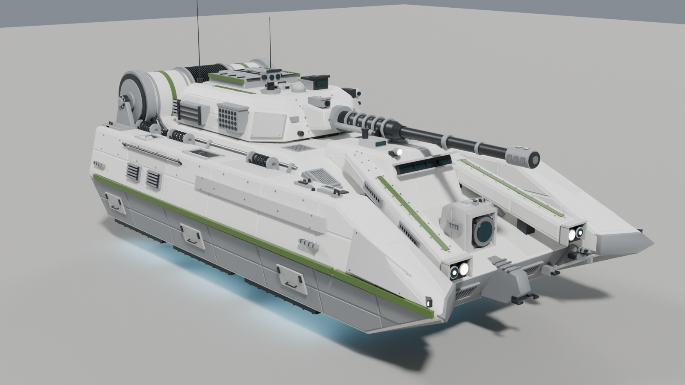
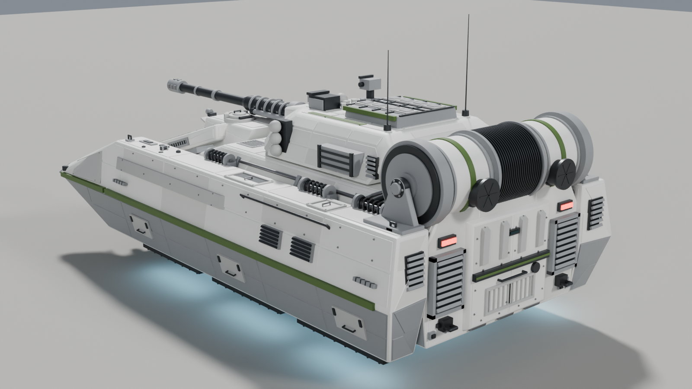
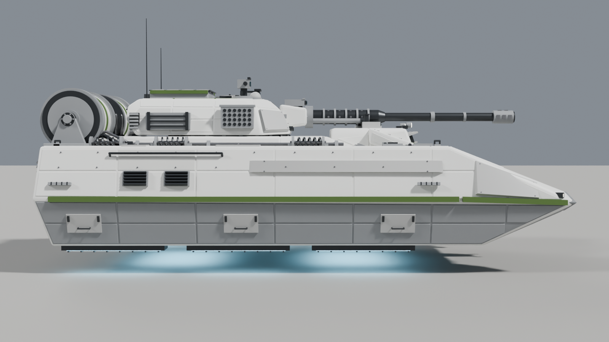
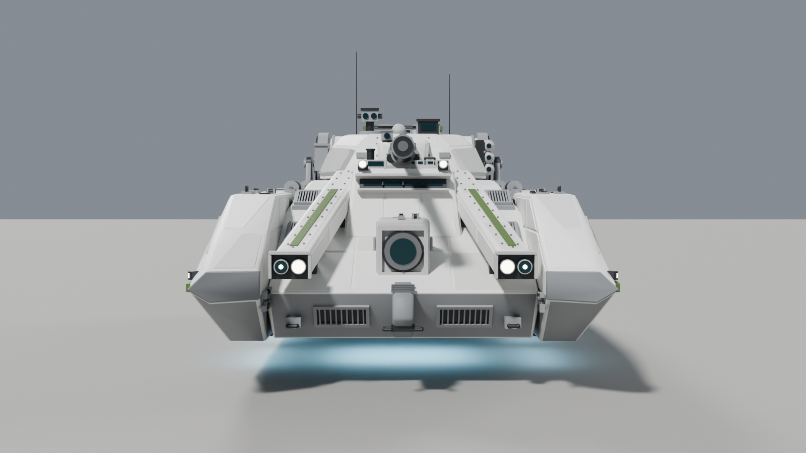
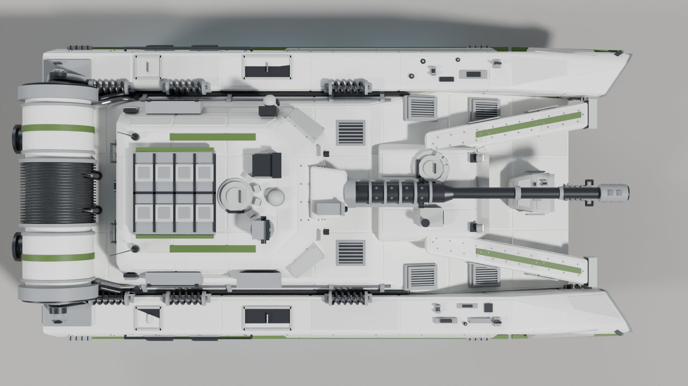
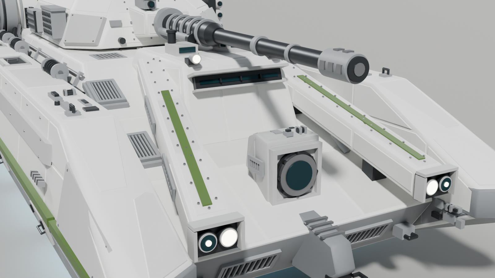
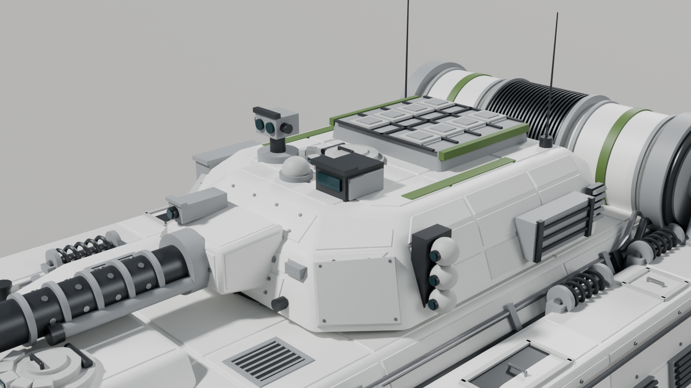
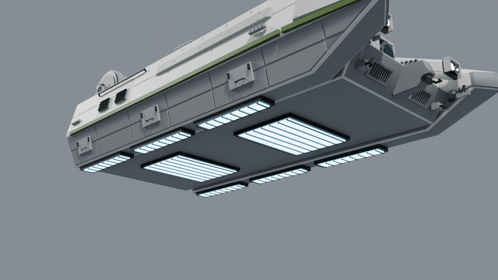
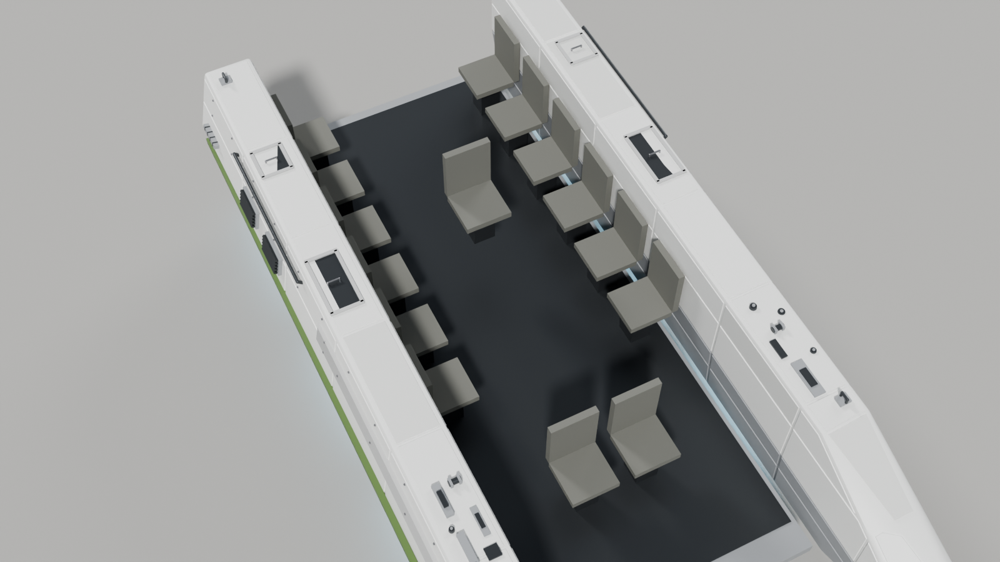

# MSE v1 — handoff

Sci-fi repulsorlift IFV for Arma 3, Bradley-sized, styled as Clone Wars era Republic armor in 41st legion markings. **MSE is a fresh design line, separate from the `hover_ifv/` attempts.** It starts from the reference sheet of a heavy Republic-style repulsor tank but is not a copy of it:

- **Slab skirts that become prongs.** Two tall slab skirts with a chined outer face run the full length and carry on past the nose as raked prongs. The prongs are cut on the diagonal, with the outer edge longest, and have a wedge side profile with dark ram caps on the tips.
- **Chevron armor arms.** Two raised arms spring from the sides of the driver's brow and run forward and outward over the glacis, leaving a shadow gap with pylons and a hydraulic ram underneath. Each ends in a twin lens cluster (headlight plus sensor) under a visor.
- **Recessed nose.** Between the arms there is a boxed sensor turret with a large round lens, and a keel plate runs underneath. The lower nose carries grilles and tow eyes.
- **Brow block** over the driver, with one long vision slit, spotlights, a round driver cupola with five periscopes, and a sensor block over the front passenger.
- **Faceted turret** carrying a 50 mm autocannon:
  - an **8-cell vertical launch system** set into the roof behind the gunner (2 × 4, hinged hatches, rockets standing upright in their cells);
  - a ball sensor cluster on the left cheek and a perforated cooling pack on the right (after the reference's gridded box), with bolt-on armor on the front cheeks;
  - gunner and commander sights, a gunner hatch with periscopes, stowage bins, bustle gills and two whip antennas.
- **Finned transverse engine drum** across the rear deck. It has sleeves, legion bands, heavy end caps with bolt circles, support brackets with bearings standing on the skirts, a cradle, coolant pipes and two exhausts.
- **Rear:** a ribbed ramp with a vision block and grille, sitting between two louvered engine boxes, plus tail lights and tow hooks.

## Detail and triangle budget

**~67,400 triangles** in the visual LOD (the target was ~70,000), leaving a little headroom.

**Rivets are kept light:** about 2,800 triangles (4%), against ~35,000 on hover_ifv v6. Bolted rows appear only where they show: the upper skirt facet, the tops of the arms, the turret and mantlet fronts, and the ramp face. Most surfaces get panel lines only.

The rest of the budget goes into greebles and hardware:
- vents, louvres and grilles
- conduit runs with clamps in the groove between skirt and hull
- coil-spring dampers between skirts and hull (a hover-suspension look)
- hatches, handles, steps, lifting eyes and grab rails
- sensor heads, bolt-on armor plates and drum hardware

**Unseen surfaces stay cheap.** The belly is plain apart from the repulsor strips and their grilles, and the panel pass skips downward faces.

| | |
|---|---|
| Hull body | 6.35 m from the rear face to the nose; the skirt prongs reach 0.80 m past the nose |
| Overall | 7.39 m from the drum exhausts to the prong tips (the gun stays inside the prongs); 3.65 m wide across the skirts |
| Height | turret roof 2.43 m, VLS hatches 2.56 m, 2.76 m to the top of the commander's sight (antenna tips higher); belly 0.45 m off the ground, lowest point 0.31 m (repulsor grilles) |
| Crew | 2 (driver, gunner) + 13 passengers = 15 seats |
| Weapons | 50 mm autocannon; 8-cell vertical launch rocket system in the turret roof |
| Propulsion | 8 repulsor strips (3 under each skirt, 2 under the belly), transverse rear engine drum with 2 exhausts |
| Visual LOD | ~67,400 triangles, ~2,800 of them rivets in separate `*_rivets` objects |

For comparison, the M2 Bradley is 6.55 m long, 3.6 m wide and 2.98 m tall. MSE v1 matches the width, sits lower, and is longer overall only because of the prongs.

## Files

- `MSE_v1.blend` is the model. It was saved with Blender 5.2, so open it in Blender 5.x.
- `MSE_v1_build.py` rebuilds the whole model from scratch. Open it in a **new empty file**, go to the Scripting tab and press Run, or run it headless:
  `blender --background --python MSE_v1_build.py -- --out MSE_v1.blend [--livery 501st]`.
  This also works in older Blender versions (4.2+) that can't open the `.blend`. Every main dimension is a named constant near the top of the script.
- `MSE_v1_render_previews.py` re-renders the preview images:
  `blender --background MSE_v1.blend --python MSE_v1_render_previews.py -- --outdir previews`.
- `previews/` holds the renders above.

The file names use `MSE_v1` with an underscore, not a space, because Arma's tool chain (Addon Builder, P3D paths in `config.cpp`) breaks on spaces in paths. Later attempts in this folder count up as `MSE_v2`, `MSE_v3` and so on.

**Legion livery:** the default is 41st green markings on Republic white. To switch, change `LIVERY` at the top of the script (or pass `--livery`) to `republic` (red), `501st` (blue) or `212th` (orange) and rerun it. Only the marking color changes.

## Conventions already applied

- 1 unit = 1 m, +Y forward, +Z up, ground at Z = 0, vehicle centered on the origin. This matches the Arma 3 Object Builder (A3OB) add-on.
- Tris and quads only, with no n-gons.
- Every object carries a **vertex group named for its Arma selection**, so the visual parts can be joined into one LOD mesh with the selections intact:
  `hull`, `turret`, `gun`, `ramp`, `hatch_driver`, `hatch_gunner`, `vls_hatch_1..8`, `rocket_1..8`, `light_l/r`, `taillight_l/r`, `glass`, `repulsor_glow`, `exhaust_glow`, `interior`.
- Animated parts have their **origin on their pivot**:

  | Part | Pivot |
  |---|---|
  | turret | ring axis |
  | gun | elevation trunnion |
  | ramp | bottom hinge |
  | driver cupola lid | rear edge |
  | gunner hatch | right edge |
  | VLS hatches | outer edge, so they flip open sideways |

  Each part with rivets has a `<name>_rivets` child that carries the same selections. The turret parts are parented to `turret` and the gun parts to `gun_mantlet`, so you can pose them in Blender.
- Sharp edges are marked, faces are shade-smooth, and basic Smart UV Project UVs are in place.

## Collections

| Collection | Contents | State |
|---|---|---|
| `LOD_Resolution_0` | The visual model, split into Hull / Skirts / Front_Armor / Hull_Details / Rear_Ramp / Engine_Drum / Repulsors / Turret / Gun / VLS_Rockets / Interior_Seats | Detailed, ready for texturing |
| `LOD_Geometry` | 8 closed convex components (hull with brow, 2 skirts, 2 armor arms, engine drum, turret with VLS block, gun), groups `Component01..08` plus `hull`/`turret`/`gun` | Usable starting point; **mass still needs to be assigned**. Hidden in the viewport by default |
| `LOD_Memory` | A vertex-only mesh with one vertex group per memory point (53, listed below) | Usable starting point |
| `Crew_Positions` | Empties `proxy_driver`, `proxy_gunner`, `proxy_cargo_01..13`, placed at the seats and facing the right way | **Placeholders**: replace them with real A3OB proxies pointing at the correct crew proxy paths |
| `LOD_FireGeometry_TODO`, `LOD_ViewGeometry_TODO` | Empty | To do |

Memory points:

| Points | What they mark |
|---|---|
| `osaveze`, `osahlavne` | turret and gun axes |
| `konec hlavne`, `usti hlavne` | breech and muzzle |
| `gunnerview`, `commanderview`, `driverview` | crew view positions |
| `ramp_axis`, `hatch_driver_axis`, `hatch_gunner_axis`, `vls_hatch_N_axis` | hinge axes |
| `pos driver`, `pos gunner`, `pos cargo` | get-in points behind the ramp |
| `light_l/r` and `_end` | headlights |
| `exhaust_l/r` and `_dir` | exhausts |
| `missile_1..8` and `missile_N_dir` | launch points, straight up from each VLS cell |
| `repulsor_1..8` | dust and glow particle effects |

## Still to do (team)

1. **Texturing and lower LODs.** The panel lines are modeled, so the texture pass is mostly weathering, 41st decals, emblems and unit numbers. It also needs a texture set (`_co`, `_nohq`, `_smdi`, `_as`) and `.rvmat` files; the current materials are placeholder colors. At ~67k triangles the model needs **lower resolution LODs** (for example ~25k, ~10k and ~3k). Drop the `*_rivets` objects, springs and greebles first.
2. **Interior.** The hull is a closed shell. Interior, view-cargo and view-pilot LODs, a turret basket and a ramp opening all still need building.
3. **Remaining LODs:** Fire Geometry, View Geometry, Shadow Volume and Land Contact.
4. **Proxies, mass, `model.cfg` and `config.cpp`.**
5. **Hover behavior is a config/scripting decision, not a modeling one.** Arma 3 has no native hover vehicle. The usual approaches are a tank or car class with invisible wheels set to the hover height, or a helicopter-class base with scripted altitude hold. Pick the approach before building the Land Contact LOD and the wheel memory points.

## Gun and turret limits for `model.cfg`

- **Rear arc: the engine drum blocks the gun.** With the gun level, the barrel meets the drum within about **±43° of straight aft**. Either stop traverse there, or force at least ~33° of elevation in that arc (the sleeve clears the drum fins at about 33° right behind the turret, easing off further out).
- **Over the brow: only about 3° of depression.** The brow top sits 5 cm under the recoil sleeve, so limit depression to about 3° in the forward arc. Over the sides the gun can depress further, since the deck and skirts are lower there.
- **The turret itself traverses a full 360°.** Its widest point is the bustle corner, at 1.68 m from the ring axis. The drum's front face sits 1.74 m out, and the brow and arms are outside the sweep. Everything on the deck inside the sweep (vents, turret ring) stays under the turret's underside.

## Design notes

- **Seating.** The driver sits under the left half of the brow and the 13th passenger beside them on the right. The other 12 passengers sit on two side benches of six at 0.60 m pitch, facing inward, with a 1.4 m aisle. The gunner hangs in the turret on the ring axis with no basket, so the aisle stays clear. All 13 passengers board over the rear ramp.
- **VLS:** the rockets stand inside the turret with their nose cones just under the hatches. Each hatch is hinged on its outer edge and swings away from the centre line. The `missile_N` / `missile_N_dir` pairs point straight up.
- **The cooling pack on the right cheek is not a launcher.** It is the reference's gridded box reworked as a perforated cooling pack, so the rockets are only ever the 8 VLS cells. The ball sensors and the commander's sight are sensors, not weapons.
- **Republic emblems, 41st camo and unit numbers belong in the texture pass**, not in the geometry. The green stripes on the skirt chines, arms, turret roof, drum and VLS frame are modeled marking bands that pick up the legion color.
