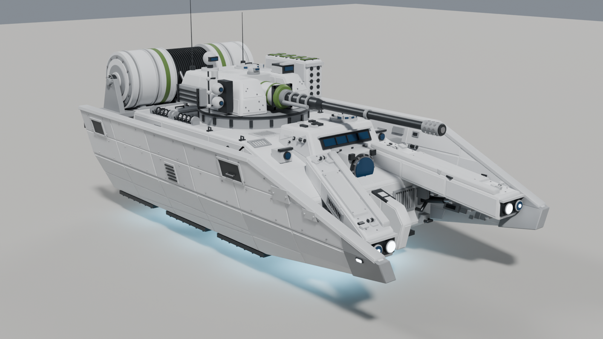
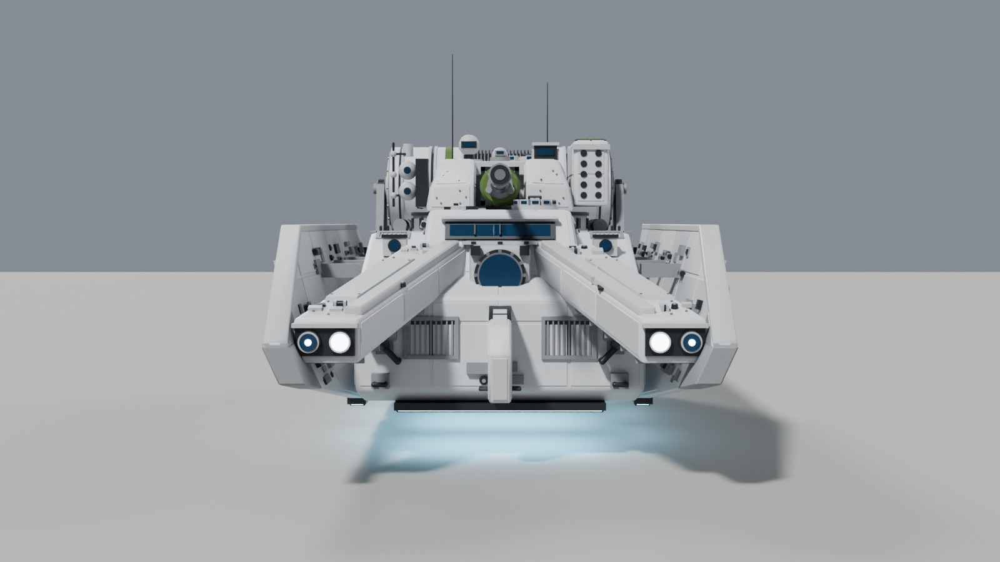
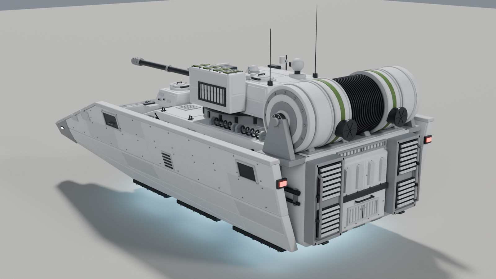
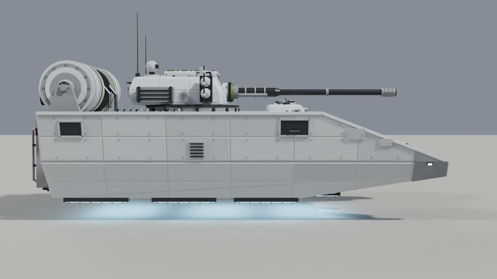
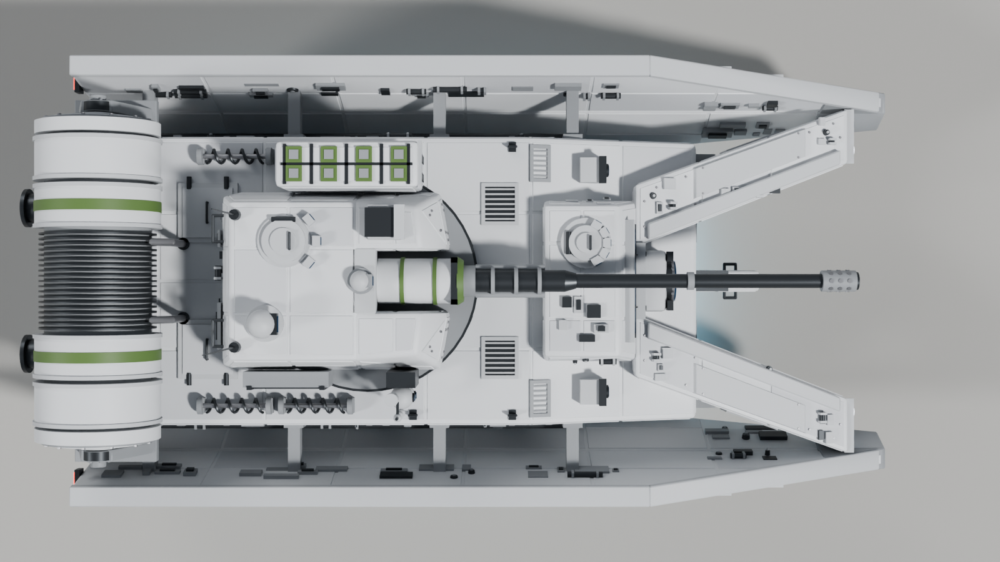
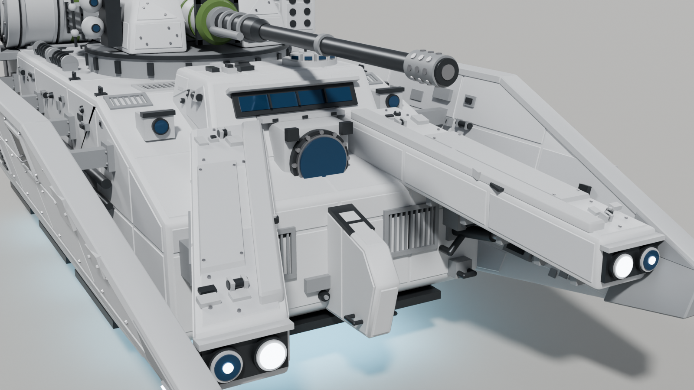
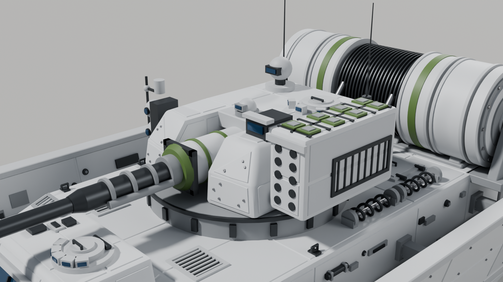
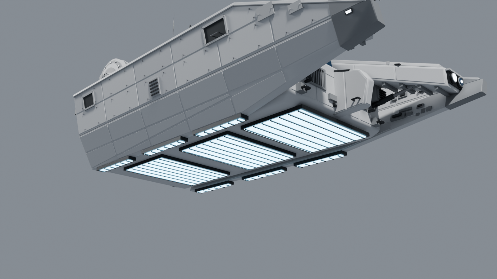
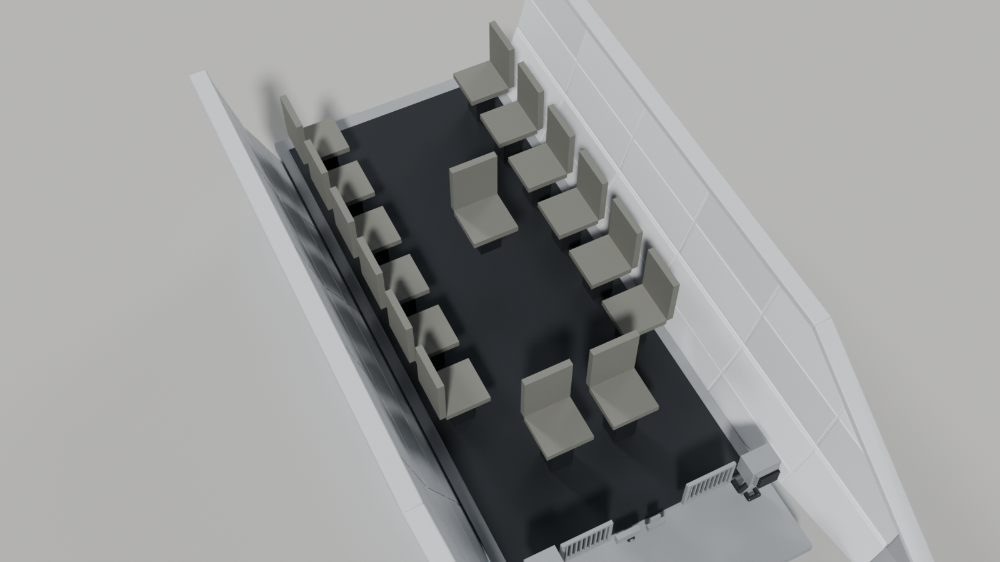

# MSE v2 — handoff

Sci-fi repulsorlift IFV for Arma 3, Bradley-sized, Clone Wars era Republic armor in 41st legion markings.

**v2 is an outward redesign of v1.** v1 still read too much like the `hover_ifv/` versions, so v2 rebuilds the exterior to follow the reference sheet much more closely, while staying an original design. The crew, weapons, Arma conventions and pipeline are unchanged from v1.

## What changed from v1

| | v1 (and hover_ifv) | v2 |
|---|---|---|
| Sides | chunky slab skirts with a bulging chine, white over a gray lower half | **thin armor walls that flare outward toward the top**, a V seen from the front, bent along a chine, with an **open gutter** between each wall and the hull |
| Prow | prongs on a solid nose | a **wedge prow** (top edge falls, bottom edge rises to a blunt tip) on each wall, with a **hollow nose** between them; the walls' inner faces, machinery boxes and hydraulic rams show under the arms |
| Arms | narrow raised bars | **wide, layered armor plates** in a big Λ, with a raised strip on the inner edge, bolted plates, greebled tops, ribbed undersides and twin lens clusters at their feet |
| Nose | boxed sensor and keel | a **porthole sensor** in a square frame at the arms' apex, with a plate band above it and a **keel rib** dropping below, as in the reference's front view |
| Driver | brow with a narrow slit | a **broad brow** with a long window on its sloped front, boxed lights at its outer corners, and a cupola |
| Turret | faceted single block | a **narrow two-cheek turret**: rear block plus two cheeks with the gun on a **cylindrical mount between them**. A **ball-and-mast sensor cluster** sits on the right, and a **box pod** on the left that **is the 8-cell VLS** (cells open upward through its roof, with the reference's grid of ports on its front face). It rides on a raised plinth |
| Deck | dampers in the skirt groove | **horizontal coil-spring dampers on the deck beside the turret**, plus troop roof hatches, grilles and tie-downs |
| Drum | finned drum on a cradle | a **larger segmented drum** (finned core, two big segments per side, stepped end caps with bolt circles) on **end brackets with bearings** |
| Rear | louvre boxes either side of the ramp | **tall boxed louvered engine modules** with pipes, a full-width top vent, and the ramp between them |
| Paint | white upper hull, gray running gear, green stripes | **one light armor gray all over** like the reference; green appears only on the drum bands, gun mount ring and VLS hatches |

## Detail and triangle budget

- **About 64,700 triangles** in the visual LOD, against a ~70,000 target, so the team has some headroom.
- **Rivets are light**, at about 2,900 triangles (under 5%). Bolted rows appear only on the upper wall facets, the arm tops, the turret cheek fronts and the ramp; everything else is panel lines.
- The rest of the budget is greebles on surfaces you actually see: gutters, wall inner faces, the hollow nose, arm tops and undersides, the turret, the drum and the rear.
- The belly stays plain apart from the repulsor pads and strips.

| | |
|---|---|
| Overall | 7.04 m from the drum exhausts to the wall prow tips (the gun stays inside the prows); 3.64 m wide across the wall tops |
| Hull | centre hull 1.10–1.16 m half-width, from the rear face (−3.15) to its recessed front face (+1.95); walls run on to the prow tips at +3.60 |
| Height | wall tops 1.85 m, turret roof 2.50 m, VLS pod top 2.68 m, about 2.8 m to the top of the sensor mast (antenna tips higher); belly 0.45 m off the ground, lowest point 0.32 m |
| Crew | 2 (driver, gunner) + 13 passengers = 15 seats |
| Weapons | 50 mm autocannon; 8-cell vertical launch rocket system in the turret's left pod |
| Propulsion | 3 repulsor pads under the belly and 3 strips under each wall foot; transverse rear engine drum with 2 exhausts |
| Visual LOD | about 64,700 triangles, about 2,900 of them rivets in separate `*_rivets` objects |

For comparison, the M2 Bradley is 6.55 m long, 3.6 m wide and 2.98 m tall.

## Files

- `MSE_v2.blend` is the model. It was saved with Blender 5.2, so open it in Blender 5.x.
- `MSE_v2_build.py` rebuilds the model from scratch. You can either:
  - open it in a **new empty file**, go to the Scripting tab and press Run, or
  - run it headless: `blender --background --python MSE_v2_build.py -- --out MSE_v2.blend [--livery 501st]`.

  It also works in Blender 4.2+, which can't open the `.blend`. The main dimensions (walls, arms, brow, turret, drum, seats) are named constants near the top of the script.
- `MSE_v2_render_previews.py` re-renders the preview images:
  `blender --background MSE_v2.blend --python MSE_v2_render_previews.py -- --outdir previews`.
- `previews/MSE_v2_*.png` are the renders above.

v1 keeps its own `MSE_v1_*` files and `previews/MSE_v1_*` images in this folder, so the two versions can be compared side by side. File names use underscores, not spaces, because Arma's tool chain breaks on spaces in paths.

**Legion livery:** the default is 41st green. To switch, change `LIVERY` (or pass `--livery`) to `republic`, `501st` or `212th` and rerun the script.

## Conventions already applied

- 1 unit = 1 m, +Y forward, +Z up, ground at Z = 0, vehicle centered on the origin. This matches the Arma 3 Object Builder (A3OB) add-on.
- Tris and quads only, with no n-gons.
- Every object carries a **vertex group named for its Arma selection**:
  `hull`, `turret`, `gun`, `ramp`, `hatch_driver`, `hatch_gunner`, `vls_hatch_1..8`, `rocket_1..8`, `light_l/r`, `taillight_l/r`, `glass`, `repulsor_glow`, `exhaust_glow`, `interior`.
- Animated parts have their **origin on their pivot**:
  - turret: ring axis
  - gun: elevation trunnion, at the centre of the cylindrical mount
  - ramp: bottom hinge
  - driver cupola lid: rear edge
  - gunner hatch: left edge
  - VLS hatches: **rear edge**, so each one flips up and back clear of its neighbours

  Each part with rivets has a `<name>_rivets` child with the same selections. Turret parts are parented to `turret` and gun parts to `gun_mount`, so you can pose them in Blender. The turret plinth is part of the hull.
- Sharp edges are marked, faces are shade-smooth, and basic Smart UV Project UVs are in place.

## Collections

| Collection | Contents | State |
|---|---|---|
| `LOD_Resolution_0` | Visual model: Hull / Side_Walls / Front_Armor / Hull_Details / Rear_Ramp / Engine_Drum / Repulsors / Turret / Gun / VLS_Rockets / Interior_Seats | Detailed, ready for texturing |
| `LOD_Geometry` | 10 closed convex components: hull with brow, 4 wall plates (upper and lower facet per side), 2 armor arms, drum, turret with VLS pod, gun. Groups `Component01..10` plus `hull`/`turret`/`gun` | Usable starting point; **mass still needs to be assigned**. Hidden in the viewport by default |
| `LOD_Memory` | Vertex-only mesh, one vertex group per memory point (54) | Usable starting point |
| `Crew_Positions` | Empties `proxy_driver`, `proxy_gunner`, `proxy_cargo_01..13` at the seats, facing the right way | **Placeholders**: replace them with real A3OB crew proxies |
| `LOD_FireGeometry_TODO`, `LOD_ViewGeometry_TODO` | Empty | To do |

Memory points:

- Axes: `osaveze` (turret), `osahlavne` (gun).
- Barrel: `konec hlavne`, `usti hlavne`.
- Views: `gunnerview`, `commanderview`, `driverview`.
- Hinges: `ramp_axis`, `hatch_driver_axis`, `hatch_gunner_axis`, `vls_hatch_N_axis`.
- Get-in points behind the ramp: `pos driver`, `pos gunner`, `pos cargo`.
- Lights: `light_l/r` and `_end`.
- Exhausts: `exhaust_l/r` and `_dir`.
- Launch points: `missile_1..8` and `missile_N_dir`, straight up from each VLS cell.
- Repulsor effects: `repulsor_1..9`.

## Gun and turret limits for `model.cfg`

- **Rear arc: the engine drum blocks the gun.** With the gun level, the barrel meets the drum within about **±46° of straight aft**. Either stop traverse there, or force at least **~27° of elevation** in that arc.
- **Forward: about 6° of depression over the brow.** The brow and the arms' roots sit under the barrel's path. Depression limits are looser over the sides.
- **The turret traverses a full 360°.** Its widest point is the rear-block corner, at 1.29 m from the ring axis. The brow (1.40 m), the drum (1.58 m) and the deck dampers, hatches and grilles all stay clear of the sweep, or under the turret body's underside at 2.00 m. The plinth below that is round and part of the hull.

## Still to do (team)

1. **Texturing and lower LODs.**
   - The texture pass is mostly weathering (the reference is heavily scuffed), plus 41st decals, emblems and unit numbers.
   - It also needs a texture set (`_co`, `_nohq`, `_smdi`, `_as`) and `.rvmat` files.
   - At ~65k triangles the model needs lower resolution LODs (for example ~25k, ~10k and ~3k). Drop the `*_rivets` objects, springs and greebles first.
2. **Interior.** The hull is a closed shell. Interior / view-cargo / view-pilot LODs, a turret basket and a ramp opening still need building.
3. **Remaining LODs:** Fire Geometry, View Geometry, Shadow Volume and Land Contact.
4. **Proxies, mass, `model.cfg` and `config.cpp`.**
5. **Hover behavior is a config/scripting decision.** The usual choices are a tank or car class with invisible wheels at hover height, or a helicopter-class base with scripted altitude hold. Pick one before building Land Contact and the wheel memory points.

## Design notes

- **Seating.** The driver sits under the left half of the brow and the 13th passenger beside them, both raised so their eyes meet the window. The other 12 passengers sit on two inward-facing side benches of six at 0.60 m pitch. The gunner hangs on the ring axis with no basket. Everyone boards over the rear ramp.
- **The walls are open-topped gutters, not sealed sponsons.** Each wall is braced to the hull by four struts and carries conduits, so the gutter reads as structure from above. If the team wants it sealed for the Geometry LOD, the wall plates are already separate convex components.
- **The VLS pod's front-face ports are decorative.** They echo the reference's gridded box, but the rockets only ever leave through the 8 roof hatches. The ball-and-mast cluster and the dome periscopes are sensors, not weapons.
