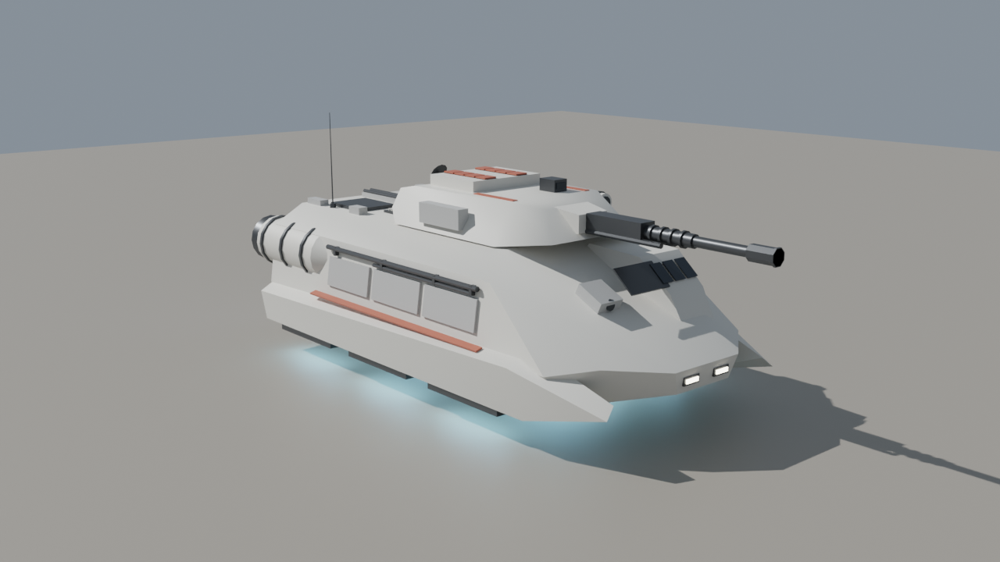
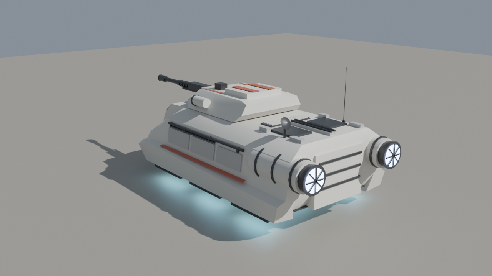
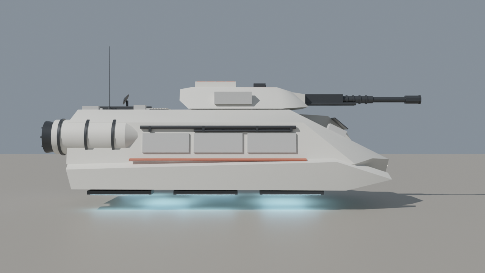
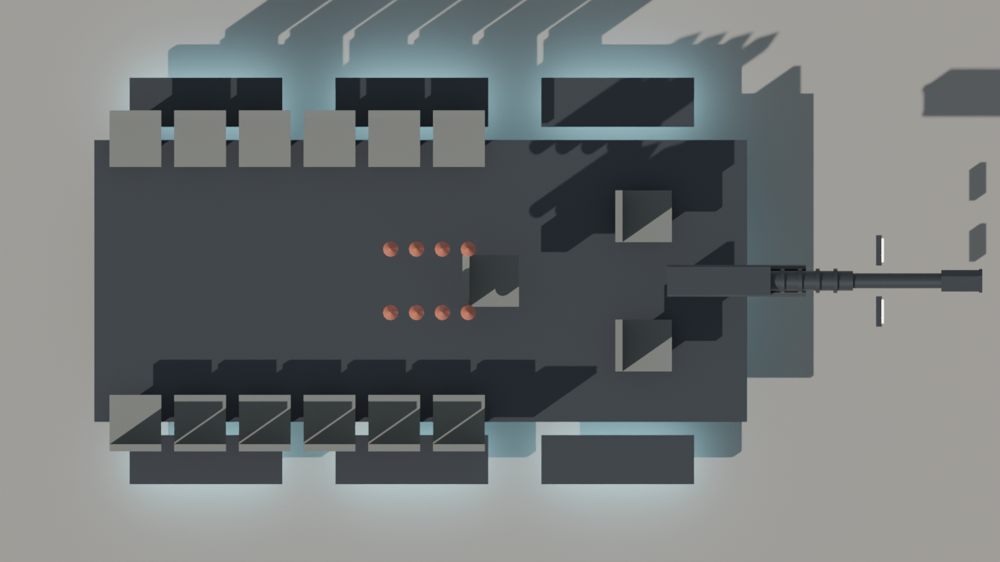

# Hover IFV — blockout handoff (v2)

Sci-fi repulsorlift IFV, Bradley-sized, built as a clean blockout for the team to polish into an Arma 3 P3D.

**v2** reworks v1 to look more like galactic-war (Star Wars-style) repulsor armor while staying an original design. It has a lower arrowhead hull with sides that lean in toward the roof, an offset armored cockpit pod with a three-pane window strip, a sensor block on the right, forward-swept repulsor pods with long glowing strips, big banded rear engine nacelles with vaned exhausts, a wider and flatter turret with a side sensor pod, a stepped blaster-style cannon with cooling rings and recoil cylinders, and much more greeble detail (pipe runs, deck spine, sensor dish, stowage boxes, red marking stripes). The seat count, weapons, selection names and pivots are unchanged from v1. The v1 files are kept alongside for comparison.

| | |
|---|---|
| Hull | 6.9 m long, 3.64 m wide, roof at 2.08 m, belly hovers 0.50 m off the ground |
| Overall | ~8.2 m from exhausts to muzzle, ~2.75 m to the top of the turret (3.44 m to antenna tip) |
| Crew | 2 (driver, gunner) + 13 passengers = 15 seats |
| Weapons | 50 mm autocannon; 8-cell vertical launch rocket system on the turret rear deck |
| Propulsion | 8 repulsor strips underneath (3 under each side pod, 2 under the belly), 2 rear engine nacelles |
| Visual LOD | ~4,300 triangles, so there is plenty of budget for detailing |

## Files

- `hover_ifv_v2.blend`: the model. It was saved with Blender 5.2, so open it in Blender 5.x.
- `build_hover_ifv_v2.py`: rebuilds the whole model from scratch. Open it in a **new empty file**, go to the Scripting tab and press Run. This also works for older Blender versions (4.2+) that can't open the `.blend`. Every dimension is a named constant near the top of the script.
- `previews/`: the renders above (the `_v1_` images show the previous version).
- `*_v1.*`: the previous version, kept for reference.

## Conventions already applied

- 1 unit = 1 m, +Y forward, +Z up, ground at Z = 0, vehicle centered on the origin. This matches the Arma 3 Object Builder (A3OB) add-on.
- Tris and quads only, with no n-gons.
- Every object carries a **vertex group named for its Arma selection**, so you can join the visual parts into one LOD mesh and keep the selections intact:
  `hull`, `turret`, `gun`, `ramp`, `hatch_cargo_l/r`, `vls_hatch_1..8`, `rocket_1..8`, `light_l/r`, `glass`, `repulsor_glow`, `exhaust_glow`, `interior`.
- Animated parts have their **origin on their pivot**: turret (ring axis), gun (elevation trunnion), ramp (bottom hinge), cargo hatches and VLS hatches (outer edge hinge). The turret parts are parented to `turret` and the gun parts to `gun_mantlet`, so you can pose them in Blender.
- Sharp edges are marked, faces are shade-smooth and basic Smart UV Project UVs are in place.

## Collections

| Collection | Contents | State |
|---|---|---|
| `LOD_Resolution_0` | The visual model, split into Hull / Hull_Details / Engines / Repulsors / Turret / VLS_Rockets / Interior_Seats | Blockout, ready for detailing |
| `LOD_Geometry` | 7 closed convex components (hull with cockpit pod, 2 side pods, 2 engine nacelles, turret, gun), groups `Component01..07` plus `hull`/`turret`/`gun` | Usable starting point; **mass still needs to be assigned**. Hidden in the viewport by default |
| `LOD_Memory` | A vertex-only mesh with one vertex group per memory point (list below) | Usable starting point |
| `Crew_Positions` | Empties `proxy_driver`, `proxy_gunner`, `proxy_cargo_01..13`, placed at the seats and facing the right way | **Placeholders**: replace them with real A3OB proxies pointing at the correct crew proxy paths |
| `LOD_FireGeometry_TODO`, `LOD_ViewGeometry_TODO` | Empty | To do |

Memory points: `osaveze` (turret axis), `osahlavne` (gun axis), `konec hlavne` / `usti hlavne` (breech/muzzle), `gunnerview`, `driverview`, `ramp_axis`, `pos driver` / `pos gunner` / `pos cargo` (get-in points behind the ramp), `light_l/r` and `_end`, `exhaust_l/r` and `_dir`, `missile_1..8` and `missile_N_dir` (straight up from each VLS cell), and `repulsor_1..8` (for dust/glow particle effects).

## Still to do (team)

1. **Detailing and texturing**: panel lines, finer greebles, weathering (a big part of the look), a final texture set (`_co`, `_nohq`, `_smdi`, `_as`) and `.rvmat` files. The current materials are placeholder colors.
2. **Interior**: the hull is a closed shell. Interior / view-cargo / view-pilot LODs, a turret basket and a ramp opening all need building.
3. **Remaining LODs**: lower resolution LODs, Fire Geometry, View Geometry, Shadow Volume and Land Contact.
4. **Proxies, mass, `model.cfg` and `config.cpp`**.
5. **Hover behavior is a config/scripting decision, not a modeling one.** Arma 3 has no native hover vehicle, so the usual approaches are a tank/car class with invisible wheels set to the hover height, or a helicopter-class base with scripted altitude hold. Pick the approach before building the Land Contact LOD and wheel memory points.

## Design notes

- 13 passengers in a Bradley footprint is tight. They sit on side benches at 0.55 m pitch, which is fine for gameplay but cramped if anyone builds a detailed interior. If that matters, stretching the hull by ~0.5 m is the easiest fix (change `CARGO_Y` and the `HULL` points in the script).
- The VLS hatches are hinged on their outer edges to flip open sideways. The rockets sit inside the turret with their nose cones just under the hatches.
- The driver sits under the offset cockpit pod on the front left and looks out through its three-pane window strip. The front passenger on the right has a periscope sensor block instead. There is no driver hatch, so the crew board through the rear ramp with everyone else.
- The cockpit pod is kept below the turret's underside so the turret can traverse a full 360 degrees over it.
