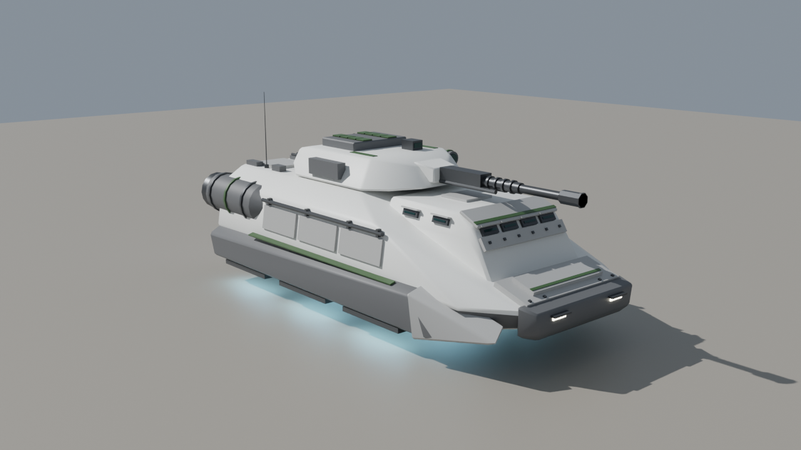
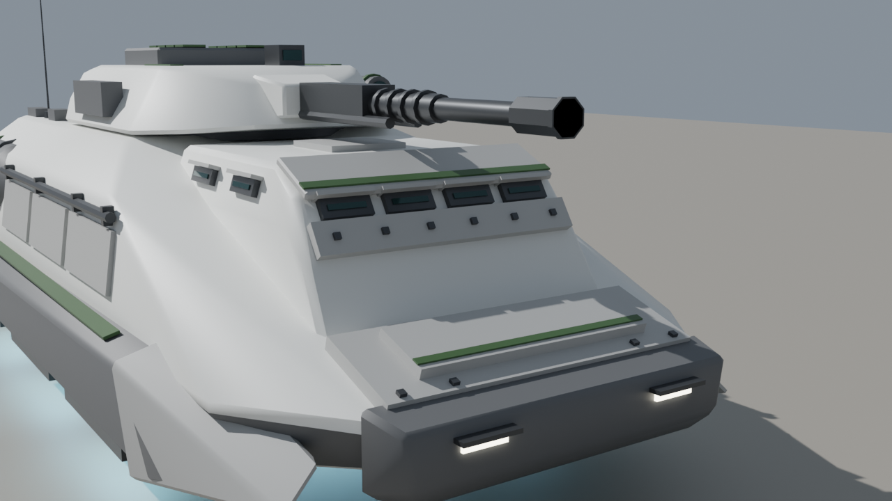
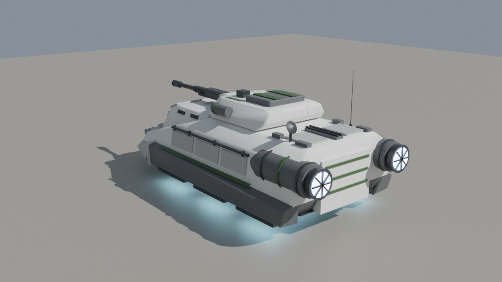
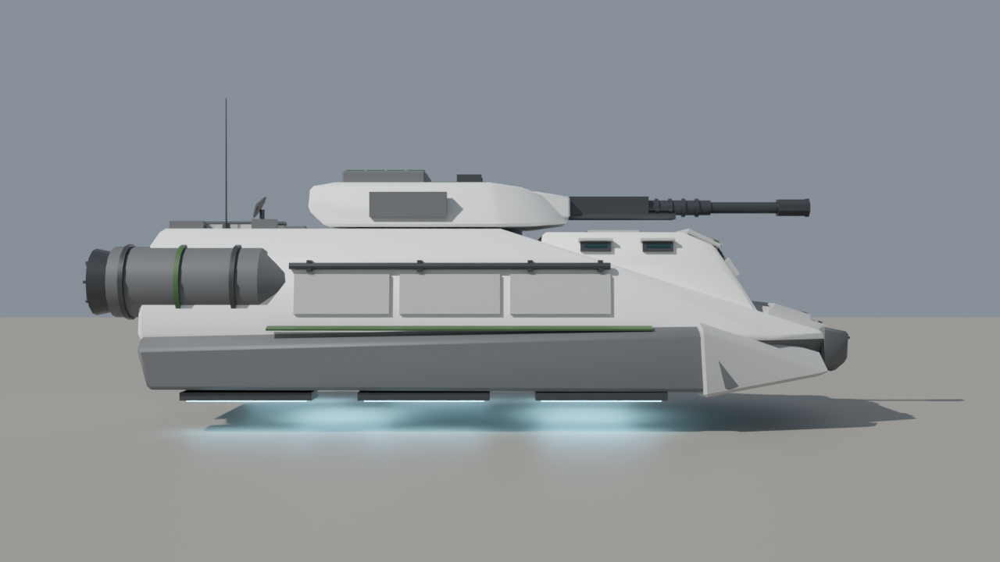
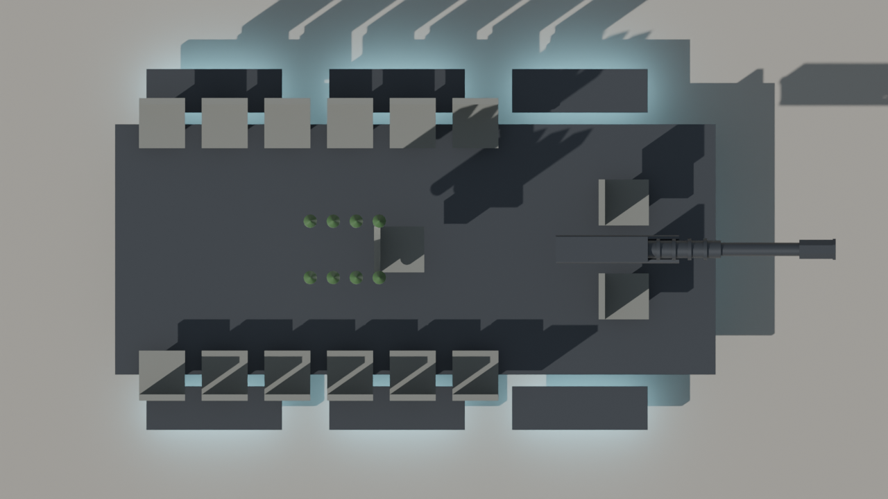

# Hover IFV — blockout handoff (v4, Clone Wars armored cab)

Sci-fi repulsorlift IFV, Bradley-sized, built as a clean blockout for the team to polish into an Arma 3 P3D.

**v4** keeps v3's Clone Wars styling and turns the crew cab into an armored compartment with more armor up front:

- **Armored cab:** the big windshield is gone. The cab front is now a steep armor face under a sloped, overhanging brow plate with a legion stripe along its edge.
- **Vision slots:** the crew look out through four narrow vision slots across the front and two on each side. Each slot is an armored block with a thin armored-glass slit and a hood above it.
- **Cab front plate:** a bolted add-on armor plate sits across the cab front, below the slots.
- **Frontal armor:** layered armor plates on the nose (replacing v3's intake grille), a heavy gray nose ram with hooded slit headlights set into it, and add-on armor caps over the front tips of both repulsor pods.

The seat count, weapons, selection names, pivots and the livery switch are unchanged from v3.

**Pick a version:** v1 (plain blockout), v2 (generic galactic-war look), v3 (Clone Wars Republic, windowed cab) and v4 (Clone Wars Republic, armored cab with vision slots) all sit in this folder with their own `.blend`, script, notes and previews, so the team can compare them side by side.

**Legion livery:** v4 defaults to 41st Elite Corps green. To switch, change `LIVERY` at the top of the script (or pass `--livery`) to `republic` (red), `501st` (blue) or `212th` (orange) and rerun it. Only the marking color changes.

The livery comparison renders were made on v3 (`previews/hover_ifv_v3_livery_*.png`). The markings work the same way on v4.

| | |
|---|---|
| Hull | 7.05 m long plus a 0.17 m nose ram, 3.68 m wide across the pod armor caps, roof at 2.05 m, belly hovers 0.50 m off the ground |
| Overall | ~7.85 m from exhausts to the front of the ram (the gun stays inside the nose), ~2.7 m to the top of the turret (3.41 m to antenna tip) |
| Crew | 2 (driver, gunner) + 13 passengers = 15 seats |
| Weapons | 50 mm autocannon; 8-cell vertical launch rocket system on the turret rear deck |
| Propulsion | 8 repulsor strips underneath (3 under each side pod, 2 under the belly), 2 rear engine nacelles |
| Visual LOD | ~5,050 triangles, so there is plenty of budget for detailing |

## Files

- `hover_ifv_v4.blend`: the model. It was saved with Blender 5.2, so open it in Blender 5.x.
- `build_hover_ifv_v4.py`: rebuilds the whole model from scratch. Open it in a **new empty file**, go to the Scripting tab and press Run. This also works for older Blender versions (4.2+) that can't open the `.blend`. Every dimension is a named constant near the top of the script.
- `previews/`: the renders above (`_v1_`, `_v2_` and `_v3_` images show the earlier versions, `_livery_` images show the alternate legion colors).
- `*_v1.*`, `*_v2.*`, `*_v3.*`: the earlier versions, kept so the team can pick a favorite.

## Conventions already applied

- 1 unit = 1 m, +Y forward, +Z up, ground at Z = 0, vehicle centered on the origin. This matches the Arma 3 Object Builder (A3OB) add-on.
- Tris and quads only, with no n-gons.
- Every object carries a **vertex group named for its Arma selection**, so you can join the visual parts into one LOD mesh and keep the selections intact:
  `hull`, `turret`, `gun`, `ramp`, `hatch_driver`, `hatch_cargo_l/r`, `vls_hatch_1..8`, `rocket_1..8`, `light_l/r`, `glass`, `repulsor_glow`, `exhaust_glow`, `interior`.
- Animated parts have their **origin on their pivot**: turret (ring axis), gun (elevation trunnion), ramp (bottom hinge), cargo hatches and VLS hatches (outer edge hinge), driver hatch (rear edge hinge). The turret parts are parented to `turret` and the gun parts to `gun_mantlet`, so you can pose them in Blender.
- Sharp edges are marked, faces are shade-smooth and basic Smart UV Project UVs are in place.

## Collections

| Collection | Contents | State |
|---|---|---|
| `LOD_Resolution_0` | The visual model, split into Hull / Hull_Details / Engines / Repulsors / Turret / VLS_Rockets / Interior_Seats | Blockout, ready for detailing |
| `LOD_Geometry` | 7 closed convex components (hull with cab and nose ram, 2 side pods with their armor caps, 2 engine nacelles, turret, gun), groups `Component01..07` plus `hull`/`turret`/`gun` | Usable starting point; **mass still needs to be assigned**. Hidden in the viewport by default |
| `LOD_Memory` | A vertex-only mesh with one vertex group per memory point (list below) | Usable starting point |
| `Crew_Positions` | Empties `proxy_driver`, `proxy_gunner`, `proxy_cargo_01..13`, placed at the seats and facing the right way | **Placeholders**: replace them with real A3OB proxies pointing at the correct crew proxy paths |
| `LOD_FireGeometry_TODO`, `LOD_ViewGeometry_TODO` | Empty | To do |

Memory points: `osaveze` (turret axis), `osahlavne` (gun axis), `hatch_driver_axis`, `konec hlavne` / `usti hlavne` (breech/muzzle), `gunnerview`, `driverview`, `ramp_axis`, `pos driver` / `pos gunner` / `pos cargo` (get-in points behind the ramp), `light_l/r` and `_end`, `exhaust_l/r` and `_dir`, `missile_1..8` and `missile_N_dir` (straight up from each VLS cell), and `repulsor_1..8` (for dust/glow particle effects).

## Still to do (team)

1. **Detailing and texturing**: panel lines, finer greebles, weathering (a big part of the look), a final texture set (`_co`, `_nohq`, `_smdi`, `_as`) and `.rvmat` files. The current materials are placeholder colors.
2. **Interior**: the hull is a closed shell. Interior / view-cargo / view-pilot LODs, a turret basket and a ramp opening all need building.
3. **Remaining LODs**: lower resolution LODs, Fire Geometry, View Geometry, Shadow Volume and Land Contact.
4. **Proxies, mass, `model.cfg` and `config.cpp`**.
5. **Hover behavior is a config/scripting decision, not a modeling one.** Arma 3 has no native hover vehicle, so the usual approaches are a tank/car class with invisible wheels set to the hover height, or a helicopter-class base with scripted altitude hold. Pick the approach before building the Land Contact LOD and wheel memory points.

## Design notes

- 13 passengers in a Bradley footprint is tight. They sit on side benches at 0.55 m pitch, which is fine for gameplay but cramped if anyone builds a detailed interior. If that matters, stretching the hull by ~0.5 m is the easiest fix (change `CARGO_Y` and the `HULL` points in the script).
- The VLS hatches are hinged on their outer edges to flip open sideways. The rockets sit inside the turret with their nose cones just under the hatches.
- The driver and front passenger sit side by side in the cab. The front slots sit just above their eye line, and the side slots cover the flanks. The driver also has a roof hatch. In game, the driver's view will normally come from a periscope/optic set up in config; `driverview` sits just behind the front slots.
- The cab roof sits 5 cm under the turret's underside so the turret can traverse a full 360 degrees over it. **The gun cannot depress much when it points forward over the cab**, so limit depression in that arc in `model.cfg`/`config.cpp`.
- Passenger seats are spaced 0.60 m apart (up from 0.55 m), using the room freed up when the driver moved forward into the cab.
- The Republic emblem, unit numbers and weathering belong in the texture pass, not in the geometry.
