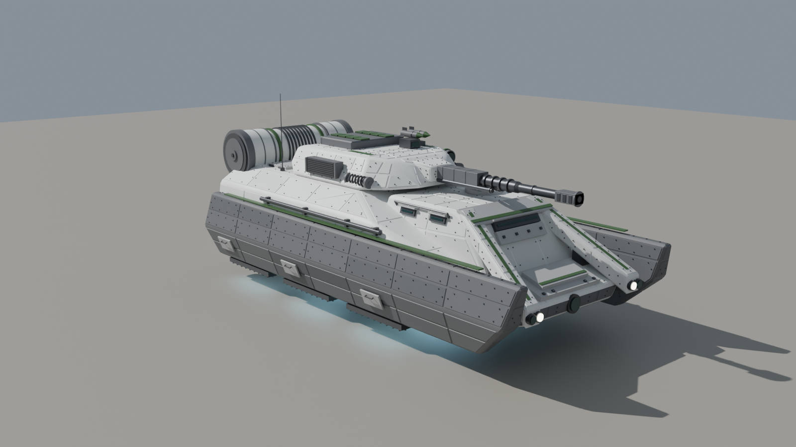
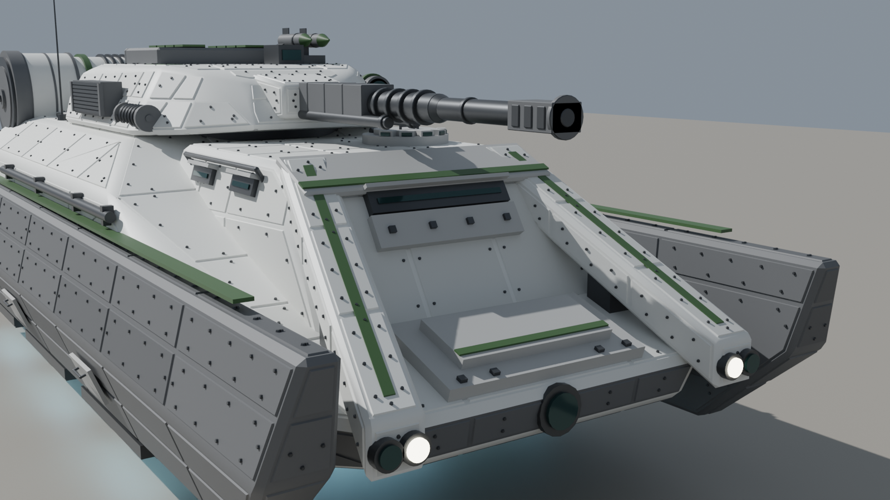
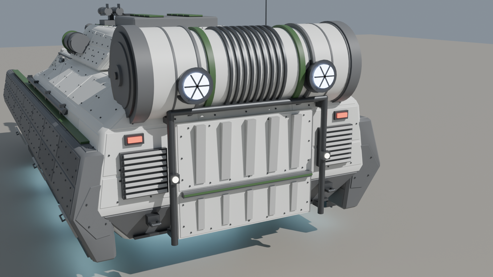
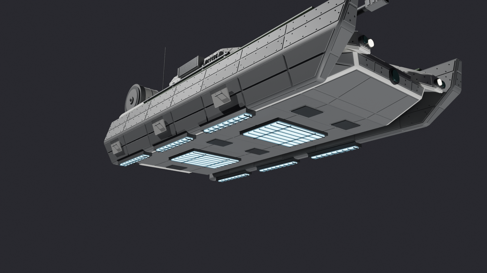
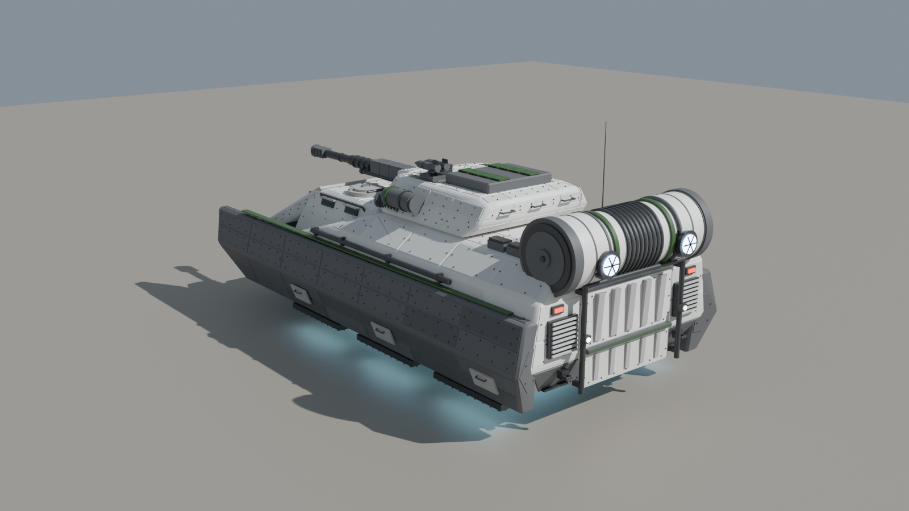
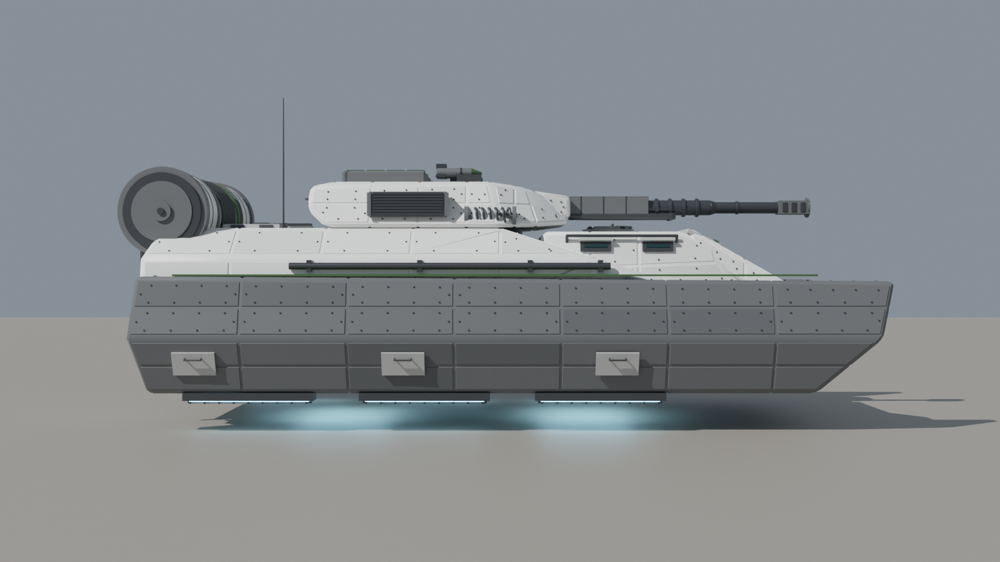
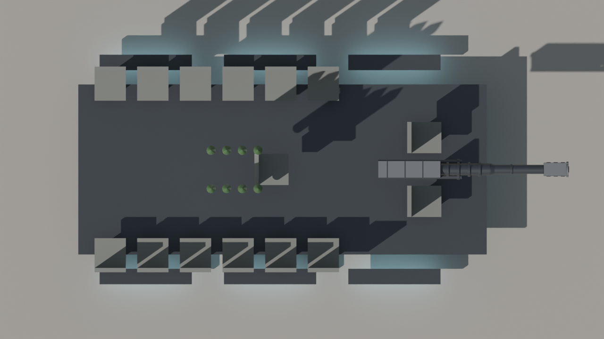

# Hover IFV — handoff (v6, high-detail slab-skirt)

Sci-fi repulsorlift IFV, Bradley-sized, built as a clean blockout for the team to polish into an Arma 3 P3D.

**v6** is a high-detail version of v5. The layout is the same, but it spends a much bigger triangle budget (about 57,000 of an allowed 70,000) on surface detail taken from the reference art:

- **Panel-lined, riveted armor** on the hull, skirts, cab, arms, turret, mantlet, ramp and roof hatches. A scripted pass cuts the armor into plates, sinks a panel line around each one, raises the plate slightly, and lines its edges with hex bolt heads. About a quarter of the plates use a slightly different shade for a patchwork look. Rivets are skipped where nobody can see them (under the vehicle, behind the skirts, on the inner skirt faces) so the triangles go where they show.
- **Engine drum assembly:** sleeved outer segments, a ribbed center, legion bands, heavy end caps with concentric rings and a hub, a cradle with side brackets, and finned exhausts.
- **Rear:** a ribbed door (tapered vertical ribs over a split lower panel with a legion ledge) inside a tubular frame with standoffs and marker lights. It also has louvered vents, red tail lights and tow hooks.
- **Turret:** coil-spring recoil dampers on both cheeks, a finned sensor/designator array on the roof (sensors, not weapons), a ringed side sensor pod, a louvered side box and grab handles on the bustle.
- **Gun:** a slotted box muzzle brake with a visible bore, recoil-cylinder collars, a step taper and shroud ribs.
- **Cab:** a round driver cupola with five periscopes. The round lid is the new `hatch_driver`, hinged at its rear edge. There are also grab rails along the cab sides.
- **Skirts:** two rows of riveted plates, plus three access hatches per side with pull handles.
- **Underside:** a panelled belly, gridded grilles over every repulsor strip, and five louvered belly vents.
- **Hatches:** the roof cargo hatches get hinges, handles and riveted edges.

**Triangle budget:** ~57,000 triangles in the visual LOD, of which ~35,000 are rivets, about a dozen `*_rivets` objects. If the budget gets tight, deleting or decimating the rivet objects is the quickest saving. Raising `rivet_step` in a part's `panels=dict(...)` in the script also thins them out.

The seat count, weapons, selection names, pivots and the livery switch are unchanged from v5, except that the square driver hatch became the cupola lid.

**Pick a version:** v1 (plain blockout), v2 (generic galactic-war look), v3 (Clone Wars Republic, windowed cab) v4 (Clone Wars Republic, armored cab with vision slots) v5 (slab-skirt redesign with armor arms and engine drum) and v6 (v5 at high detail, ~57k triangles) all sit in this folder with their own `.blend`, script, notes and previews, so the team can compare them side by side.

**Legion livery:** v6 defaults to 41st Elite Corps green. To switch, change `LIVERY` at the top of the script (or pass `--livery`) to `republic` (red), `501st` (blue) or `212th` (orange) and rerun it. Only the marking color changes.

The livery comparison renders were made on v3 (`previews/hover_ifv_v3_livery_*.png`). The markings work the same way on v6.

| | |
|---|---|
| Hull | 7.05 m long, with the skirt prongs reaching 0.45 m past the nose; 3.67 m wide across the skirts; roof at 2.05 m, belly hovers 0.50 m off the ground |
| Overall | ~7.87 m from the drum exhausts to the skirt prong tips (the gun stays inside the prongs), ~2.7 m to the top of the turret (3.41 m to antenna tip) |
| Crew | 2 (driver, gunner) + 13 passengers = 15 seats |
| Weapons | 50 mm autocannon; 8-cell vertical launch rocket system on the turret rear deck |
| Propulsion | 8 repulsor strips underneath (3 under each skirt, 2 under the belly), transverse rear engine drum with 2 exhausts |
| Visual LOD | ~57,000 triangles (cap was 70,000); ~35,000 of them are rivets in separate `*_rivets` objects |

## Files

- `hover_ifv_v6.blend`: the model. It was saved with Blender 5.2, so open it in Blender 5.x.
- `build_hover_ifv_v6.py`: rebuilds the whole model from scratch. Open it in a **new empty file**, go to the Scripting tab and press Run. This also works for older Blender versions (4.2+) that can't open the `.blend`. Every dimension is a named constant near the top of the script.
- `previews/`: the renders above (`_v1_` to `_v5_` images show the earlier versions, `_livery_` images show the alternate legion colors).
- `*_v1.*` to `*_v5.*`: the earlier versions, kept so the team can pick a favorite.

## Conventions already applied

- 1 unit = 1 m, +Y forward, +Z up, ground at Z = 0, vehicle centered on the origin. This matches the Arma 3 Object Builder (A3OB) add-on.
- Tris and quads only, with no n-gons.
- Every object carries a **vertex group named for its Arma selection**, so you can join the visual parts into one LOD mesh and keep the selections intact:
  `hull`, `turret`, `gun`, `ramp`, `hatch_driver`, `hatch_cargo_l/r`, `vls_hatch_1..8`, `rocket_1..8`, `light_l/r`, `glass`, `repulsor_glow`, `exhaust_glow`, `interior`.
- Animated parts have their **origin on their pivot**: turret (ring axis), gun (elevation trunnion), ramp (bottom hinge), cargo hatches and VLS hatches (outer edge hinge), driver cupola lid (rear edge hinge). Each panelled part's `<name>_rivets` child carries the same selections as its parent, so rivets move with turret, gun, ramp and hatches. The turret parts are parented to `turret` and the gun parts to `gun_mantlet`, so you can pose them in Blender.
- Sharp edges are marked, faces are shade-smooth and basic Smart UV Project UVs are in place.

## Collections

| Collection | Contents | State |
|---|---|---|
| `LOD_Resolution_0` | The visual model, split into Hull (with skirts and arms) / Hull_Details / Engines (drum) / Repulsors / Turret / VLS_Rockets / Interior_Seats | Blockout, ready for detailing |
| `LOD_Geometry` | 6 closed convex components (hull with cab and armor arms, 2 skirts, engine drum, turret, gun), groups `Component01..06` plus `hull`/`turret`/`gun` | Usable starting point; **mass still needs to be assigned**. Hidden in the viewport by default |
| `LOD_Memory` | A vertex-only mesh with one vertex group per memory point (list below) | Usable starting point |
| `Crew_Positions` | Empties `proxy_driver`, `proxy_gunner`, `proxy_cargo_01..13`, placed at the seats and facing the right way | **Placeholders**: replace them with real A3OB proxies pointing at the correct crew proxy paths |
| `LOD_FireGeometry_TODO`, `LOD_ViewGeometry_TODO` | Empty | To do |

Memory points: `osaveze` (turret axis), `osahlavne` (gun axis), `hatch_driver_axis`, `konec hlavne` / `usti hlavne` (breech/muzzle), `gunnerview`, `driverview`, `ramp_axis`, `pos driver` / `pos gunner` / `pos cargo` (get-in points behind the ramp), `light_l/r` and `_end`, `exhaust_l/r` and `_dir`, `missile_1..8` and `missile_N_dir` (straight up from each VLS cell), and `repulsor_1..8` (for dust/glow particle effects).

## Still to do (team)

1. **Texturing and lower LODs**: the panel lines and rivets are modeled, so the texture pass is mostly weathering (a big part of the look), decals and a final texture set. At 57k triangles the model needs proper **lower resolution LODs** (for example ~25k, ~10k and ~3k, dropping rivets first), plus a texture set (`_co`, `_nohq`, `_smdi`, `_as`) and `.rvmat` files. The current materials are placeholder colors.
2. **Interior**: the hull is a closed shell. Interior / view-cargo / view-pilot LODs, a turret basket and a ramp opening all need building.
3. **Remaining LODs**: lower resolution LODs, Fire Geometry, View Geometry, Shadow Volume and Land Contact.
4. **Proxies, mass, `model.cfg` and `config.cpp`**.
5. **Hover behavior is a config/scripting decision, not a modeling one.** Arma 3 has no native hover vehicle, so the usual approaches are a tank/car class with invisible wheels set to the hover height, or a helicopter-class base with scripted altitude hold. Pick the approach before building the Land Contact LOD and wheel memory points.

## Design notes

- 13 passengers in a Bradley footprint is tight. They sit on side benches at 0.55 m pitch, which is fine for gameplay but cramped if anyone builds a detailed interior. If that matters, stretching the hull by ~0.5 m is the easiest fix (change `CARGO_Y` and the `HULL` points in the script).
- The VLS hatches are hinged on their outer edges to flip open sideways. The rockets sit inside the turret with their nose cones just under the hatches.
- The driver and front passenger sit side by side in the cab. The long front slit sits just above their eye line, and the side slots cover the flanks. The driver also has a roof hatch. In game, the driver's view will normally come from a periscope/optic set up in config; `driverview` sits just behind the front slit.
- The cab roof sits 5 cm under the turret's underside so the turret can traverse a full 360 degrees over it. **The gun cannot depress much when it points forward over the cab**, so limit depression in that arc in `model.cfg`/`config.cpp`.
- Passenger seats are spaced 0.60 m apart (up from 0.55 m), using the room freed up when the driver moved forward into the cab.
- The Republic emblem, unit numbers and weathering belong in the texture pass, not in the geometry.
